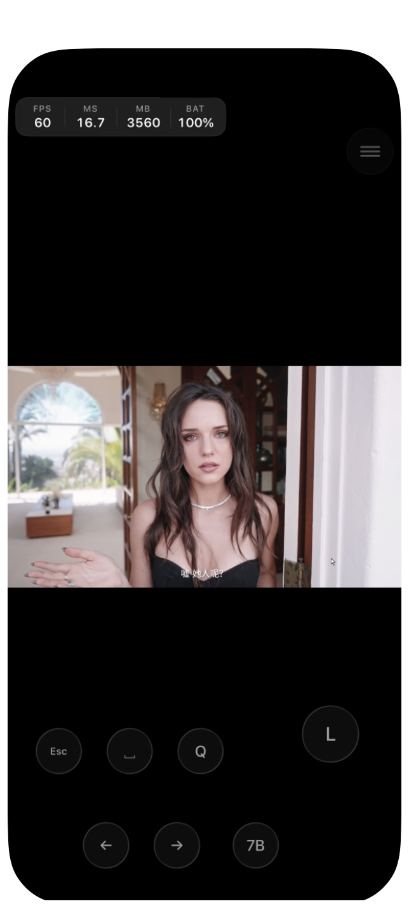
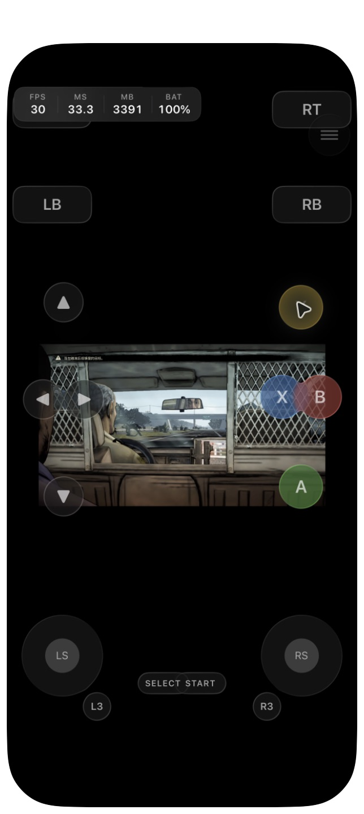

# 测试记录怎么读

这里仅发布整理后的结果和数值，不上传完整设备日志、账号信息或个人存档。帧率来自短时叠层观察；睡狗另有内置 Benchmark。所有游戏都没有完成全流程和长时间温控测试。

| 日期 | 游戏 | 具体证据 | 保留的限制 |
| --- | --- | --- | --- |
| 11/05 | 港诡实录 | 旧存档载入；方向键菜单、Enter、蹲起、暂停有画面响应；短时 40–49 FPS | 转向有尖峰，复杂操作未覆盖 |
| 11/05–06 | 睡狗 | 旧云档、基础移动/转向/暂停；Benchmark 平均约 33、最低 21、最高 51 FPS；手机中文菜单及自动保存提示 | 未完成持续战斗、驾驶；汉化全剧情未验证 |
| 11/09 | 冒牌富少 | VA-floor 包安装后实际第四章剧情；约 59–60 FPS；中文剧情字幕正确 | 只覆盖当时短场景；转场出现过 42–43 FPS |
| 11/09 | 武士零 | 屋顶教程移动、A 跳跃、X 挥刀击杀、Start 暂停；60 FPS；第二次冷启动到主菜单 | 新测试进度隔离；原云文件有未映射 |
| 11/09 | 行尸走肉合集 | 第一季第一章警车场景；菜单/右摇杆有响应；44–55 FPS，锁 30 更稳 | 场景交互不可靠，另两次冷启动挂起，未确认正常可玩 |
| 11/11 | 冒牌富少 test4 | 原进度继续至剧情、视频和字幕正常、Space/Esc 可用；产生测试检查点 | 云上传临时隔离，未选剧情分支 |
| 11/11 | 冒牌富少 test5 | 完整结束 Madeira，再启用 JIT；继续到刚保存的检查点，约 60 FPS | 这轮退出复现最后一帧残留 |
| 11/11 | 冒牌富少 test6 | 恢复原进度和 Cloud ON；77 秒出现游戏窗口；继续返回原章节回顾 | JIT 用 Mac 辅助的现有 PID 入口 |
| 11/11 12:57 | 冒牌富少安全退出 | 上传 1 文件；same=5、differ=0、ask=0；日志确认 closing Madeira，进程已结束 | 没有把测试用第五章进度上传 |
| 11/11 12:58 | 冒牌富少重新打开 | same=5、differ=0、upload=0、download=0、ask=0；界面 In sync | 此次重开是游戏库和云状态核对 |

Hades 由我先行自测后转去排查其他游戏，没有保留与上表同样完整的操作和帧率记录。

冒牌富少最终存档与测试前比较：剧情节点、已激活节点、分支变量值、设置和成就状态一致；只刷新了 PersistentVariables 中的修改时间。临时配置已撤回，全局及游戏 cfg 与工作基线一致。

本仓库没有把 `launch-client-error=0`、云文件一致或游戏窗口出现单独算作“正常可玩”。

## 实际画面

《冒牌富少》：11/09 中文剧情字幕、触屏布局和约 60 FPS 的叠层。只代表截图时的场景。

《行尸走肉合集》：11/09 第一季第一章警车场景，30 FPS 上限。画面已经出来，但交互和再次启动没有可靠通过，所以仍记为部分可运行。

## 发布前复现检查

11/11 用原始 Madeira IPA 和正版游戏原始主程序重新生成修正版，输出主程序的 SHA-256 与实机用过的版本一致。IPA 仅主程序和构建标记改变，其余条目逐个核对未变。字体工具在本机导出的注册表上补了 8 条 32 位注册。

7 项脚本测试通过。校验结果见 [build-validation.json](build-validation.json)；这是离线复现检查，不代表又完成了一轮手机游玩测试。
